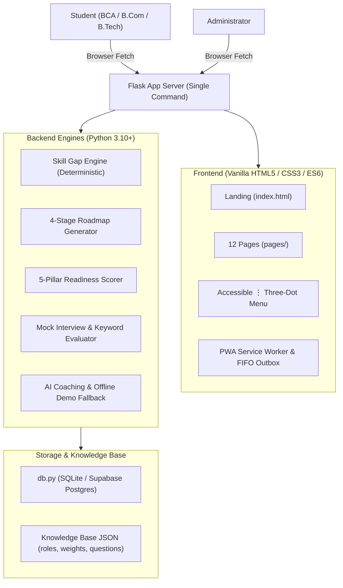

# InternPath AI – Your Skills. Your Roadmap. Your Internship.

InternPath AI is a production-grade, demo-ready final-year BCA project designed to bridge the gap between college coursework and career readiness. It provides undergraduate students across technical and non-technical fields (BCA, B.Tech, B.Com, BBA, MCA, MBA) with a personalized, deterministic skill-gap analysis, an actionable 4-stage roadmap, curated learning resources, project recommendations, mock interview practice, and transparent readiness scoring.

---

## 🏛 Architecture Diagram



---

## 🗺️ Guided 6-Step Internship Pathway

InternPath AI guides students through an intuitive, structured progression to ensure they are fully prepared before applying:

```
Login 
  ↓
Step 1: Choose Target Role (12+ Tech & Non-Tech Roles)
  ↓
Step 2: Skill Gap Analyzer (Interactive Low 0.4 / Medium 0.7 / High 1.0 Selection)
  ↓
Step 3: Stage-by-Stage Roadmap (Embedded Learning Hub: Videos, Docs, Practice)
  ↓
Step 4: Portfolio Projects (Role-Recommended + Custom with GitHub & PDF Report)
  ↓
Step 5: Internship Readiness Score (Deterministic 0-100%, 65% Threshold Banner, 9-Item Checklist)
  ↓
Step 6: Application Profile (Resume Upload, LinkedIn & GitHub Links Verification)
  ↓
Final Destination: Matched Internships (with "Prepare to Apply" Credentials Verification Panel)
```

---

## 🎯 Objective to Feature Traceability

| Objective | Description | Working Feature | Verified In Code |
| :--- | :--- | :--- | :--- |
| **Obj 1** | Register/login with student and admin access | Role-based session auth, bcrypt/werkzeug hashing, rate limiting | `backend/routes/auth.py` |
| **Obj 2** | Comprehensive student profile | Course, semester, skills with level, projects, certifications, resume checklist | `frontend/pages/profile.html` |
| **Obj 3** | Role selection (12+ roles, tech & non-tech) | 12 industry roles in `knowledge_base/roles.json`, dynamic filtering | `backend/services/role_helper.py` |
| **Obj 4** | Deterministic skill-gap analysis | Importance multipliers (Core=3, Imp=2, Bonus=1) and level scores (0.4, 0.7, 1.0) | `backend/services/skill_gap_service.py` |
| **Obj 5** | Personalized 4-stage roadmap | Foundation → Practice → Project → Interview derived from missing skills | `backend/services/roadmap_service.py` |
| **Obj 6** | Learning and Practice Hub | Video tutorials, documentation, and practical exercises with completion toggles | `backend/routes/resources.py` |
| **Obj 7** | Project recommendations with milestones | Role-matched projects, milestone completion tracking, status management | `backend/routes/projects.py` |
| **Obj 8** | Interview preparation & AI mock test | Role-tailored questions (no coding for non-tech), 4-criteria rubric evaluation (0–5), server score calculation, model answer accordion, side-by-side comparison, retry with improvement, and weak topic drills | `backend/services/interview_service.py` |
| **Obj 9** | Transparent readiness score | 5-pillar weighted formula (35% skills, 25% projects, 15% resume, 20% interview, 5% certs) | `backend/services/readiness_service.py` |
| **Obj 10** | Internship matching engine | Ranked match percentage based on skills (60%), role (25%), and interests (15%) | `backend/services/matching_service.py` |
| **Obj 11** | Progress tracking from saved activity | Real-time aggregate metric calculations across skills, tasks, and test accuracy | `backend/routes/progress.py` |
| **Obj 12** | Full stack integration | Flask backend + Vanilla JS frontend + SQLite database + AI/Demo service | `run.py`, `backend/app.py` |
| **Obj 13** | Extensibility for ML & resume parsing | Clean service architecture ready for future NLP and live API extensions | `docs/ARCHITECTURE.md` |

---

## 🚀 Quick Start Instructions

### Windows (1-Click)
Double-click `start.bat` in the project root folder.

### macOS & Linux
```bash
chmod +x start.sh
./start.sh
```

### Manual Execution
```bash
python -m venv venv
# Windows:
venv\Scripts\activate
# Linux/Mac:
source venv/bin/activate

pip install -r requirements.txt
python scripts/setup_wizard.py
python run.py
```
Open your browser to: **`http://localhost:5000`**

---

## 🔑 Demo Logins

| Role | Email | Password | Preloaded Background |
| :--- | :--- | :--- | :--- |
| **Student (BCA)** | `student@demo.com` | `Student@123` | Python Developer track, preloaded skills & project |
| **Student (B.Com)** | `priya@demo.com` | `Student@123` | Finance Analyst track, non-technical skills & project |
| **Administrator** | `admin@demo.com` | `Admin@123` | Read-only platform analytics & student distribution |

---

## 📊 Deterministic Readiness Score Algorithm Explained

The Internship Readiness Score is 100% deterministic, transparent, and auditable:

$$\text{Overall Score} = \frac{\sum (\text{Category Score} \times \text{Weight})}{\sum \text{Weights}}$$

1. **Skills (35% default):** Calculated directly from your skill-gap weighted percentage. Core missing skills penalize heavily.
2. **Projects (25% default):** Evaluated strictly if project keywords match role prerequisites. Completed projects award full credit; in-progress award half credit.
3. **Resume (15% default):** Evaluates a 6-item checklist (PDF existence, matching skills, quantifiable project, contact info).
4. **Interview (20% default):** Derived from practice volume (30%), accuracy % (40%), and completed mock sessions (30%).
5. **Certifications (5% default):** Grants credit only for credentials matching role certification keywords.

> **Honesty & Safety Principle:** The AI coaching assistant writes friendly encouragement and improvement tips, but **NEVER** modifies or computes the numeric readiness score.

---

## 🔒 Security & Privacy Features (Phase 9b)
* **CSRF Token Verification:** `X-CSRF-Token` header validated on all state-changing `POST`, `PUT`, and `DELETE` requests.
* **Rate Limiting:** 5 consecutive failed login attempts trigger an automatic 5-minute lockout.
* **Daily AI Quota:** Enforces a limit of 30 AI calls per user per day before politely switching to rule-based demo mode.
* **Security Headers:** Equipped with `X-Content-Type-Options: nosniff`, `X-Frame-Options: SAMEORIGIN`, and SameSite cookie protection.
* **Privacy Data Purge:** One-click "Delete My Account" permanently deletes user records across all database tables.

---

## 🧪 Automated Testing
Run the complete automated test suite (37 unit & integration tests):
```bash
pytest
```

---

## 📚 References & Acknowledgments
1. **Flask Web Framework:** [Pallets Projects Documentation](https://flask.palletsprojects.com/)
2. **SQLite:** [SQLite In-Process Database Engine](https://www.sqlite.org/)
3. **Career Readiness Indicators:** NACE Career Readiness Competencies Framework.
4. **MDN Web Docs:** [HTML, CSS, JavaScript, and Web APIs](https://developer.mozilla.org/)
5. **OpenAI API:** [OpenAI Platform Documentation](https://platform.openai.com/docs/)

---

## ⚠️ Known Limitations & Future Work
* **Self-Reported Skill Levels:** The current version relies on self-reported proficiencies (Beginner, Intermediate, Advanced). Future work can incorporate automated coding sandboxes.
* **Demo Opportunities:** Sample internship listings are demonstrative and labeled accordingly. Future work will integrate live verified job APIs.
* **Resume Parsing:** Currently uses a structured checklist. Future work will include NLP-based automated PDF resume text extraction.
