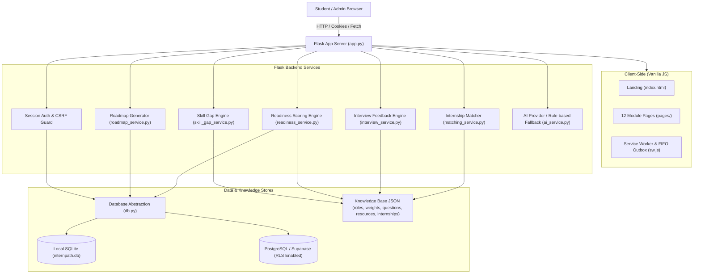

# InternPath AI - Technical Architecture

## 1. Architectural Overview
InternPath AI is designed as a modular, lightweight monolithic web application adhering strictly to the **Single Responsibility Principle**.
The system couples a vanilla HTML5/CSS3/JavaScript frontend directly served by a Python Flask application server.

## 2. Key Design Decisions
1. **No External Frontend Frameworks:** HTML5, CSS3, and vanilla JS prevent dependency churn and make every line easily explainable in an academic viva.
2. **Deterministic-First AI Architecture:** AI is strictly an encouraging assistant. Scores, roadmap stages, and match rankings are computed deterministically via transparent weighted algorithms.
3. **Database Abstraction:** `backend/db.py` handles translation of `?` and `%s` placeholders, row-to-dictionary mapping, and lastrowid differences between SQLite and Supabase PostgreSQL.
4. **Data Structures Utilized:**
   - **Lists:** Ordered roadmap stages, interview questions, and priority gap outputs.
   - **Dictionaries:** $O(1)$ fast lookups for roles by ID and skills by name.
   - **Sets:** Set intersection for skill coverage and internship keyword checks.
   - **FIFO Queue:** Offline service worker outbox for queued status synchronizations.
   - **Database Indexes:** Performance acceleration on `user_id`, `role_id`, and `created_at`.
